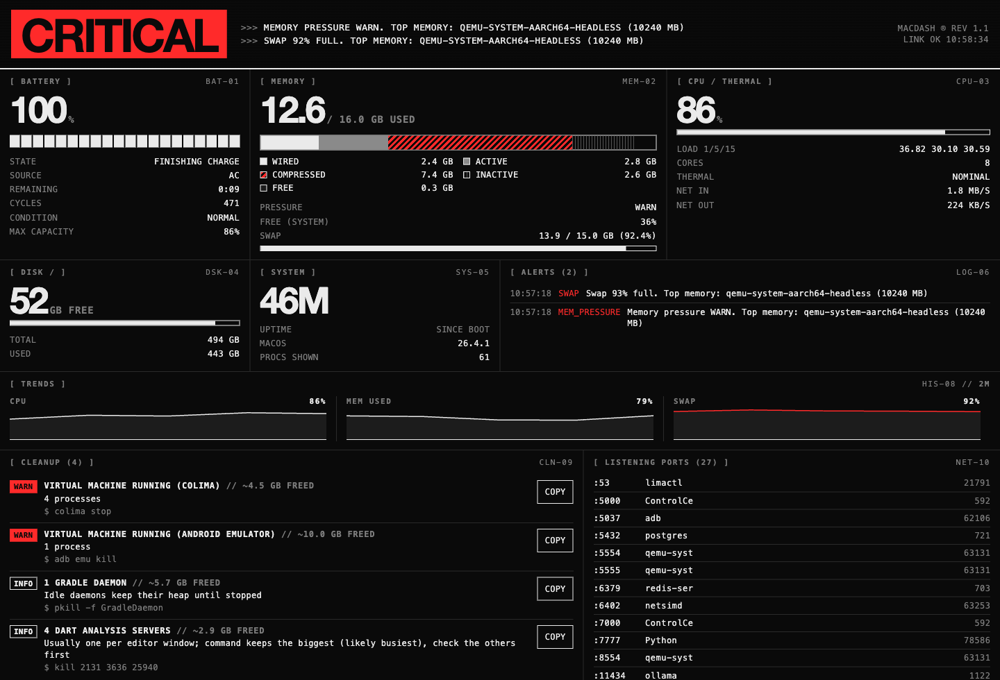

# macdash

**Find out why your Mac is slow.** A local dashboard that shows RAM, swap, CPU, thermal throttling, battery, disk and every running task. It sends a macOS notification when the battery is low or the Mac starts struggling. It also ships as a **Claude Code plugin**, so Claude can read the same live data and tell you what to close.



- **Lightweight.** It's one Python file and one HTML page, using only the standard library. There are no pip installs, no Electron app and no npm.
- **Private.** It binds to `127.0.0.1` only, is read-only (no kill or exec endpoints), rejects foreign `Host` headers, and makes no network calls.
- **Accurate on Apple Silicon.** Memory figures use `top`'s real footprint, which includes compressed and swapped pages that `ps` RSS misses. Throttling is read from macOS's thermal state, since `pmset -g therm` doesn't work on M-series chips.

## Install

```sh
git clone https://github.com/AnshRajput/macdash.git
cd macdash && sh install.sh
open http://127.0.0.1:7777
```

`install.sh` copies the app to `~/.macdash`, registers a LaunchAgent (`dev.macdash`) so macdash starts at login and restarts if it crashes, and installs `terminal-notifier` via Homebrew (clicking an alert opens the dashboard). You need macOS and `python3`.

Uninstall with `sh uninstall.sh`.

## Use it from Claude Code

```
/plugin marketplace add AnshRajput/macdash
/plugin install macdash@macdash
```

Then just ask: *"why is my Mac lagging?"*, *"what's eating my RAM?"*, or *"what's running right now?"* Claude starts macdash if needed, reads `/api/stats`, explains the biggest causes, and flags the usual leftovers: stale dev servers, booted simulators, Docker/Colima VMs, idle Gradle daemons and runaway `git` processes. It proposes exact commands and **never kills anything without your OK**.

## What it shows

| Panel | Details |
|---|---|
| Verdict | `OK` / `STRAINED` / `CRITICAL`, with the reason and the top offender |
| Battery | Percent, charging state, power source, time remaining |
| Memory | Wired / active / compressed / inactive / free, memory pressure, swap |
| CPU / thermal | Overall %, load averages, cores, thermal state (nominal → critical) |
| Disk / system | Free space, uptime, macOS version |
| Battery health | Cycle count, condition, maximum capacity (API) |
| Network | Live in/out bytes per second (API) |
| Listening ports | Every TCP listener with its pid and command (API) |
| Cleanup suggestions | Stale dev servers, booted simulators, VMs, Gradle daemons, hung `flutter_tester`/`git`, duplicate Dart analysis servers, memory leaks, each with a command to review and run yourself (API) |
| History | Last 2h of CPU, memory, swap, pressure, battery and network samples (API) |
| Alerts | The last 50 alerts |
| Tasks running | Sortable, filterable process table (memory, CPU, uptime, full command) with a group-by-app toggle |

## Alerts

The checks run every 30s. Each alert has a 15-minute cooldown. The cooldown is not reset when a condition briefly clears, and a worse severity (for example swap 80% to 95%) alerts immediately.

- Battery **below 20%** and not charging, and **below 10%** (critical)
- Disk free space **below 10 GB**
- A process whose memory **grew by 500 MB and 50%** in 30 minutes (leak watch)
- Memory pressure **warn** or **critical**
- Swap **more than 75%** full
- Thermal state **serious** or **critical** (the Mac is throttling)
- CPU **above 90%** for 3 checks in a row

### Configuration

Optional `~/.macdash/config.json` (or the path in `MACDASH_CONFIG`), read at startup. Missing keys, bad values or an invalid file fall back to the defaults:

```json
{"battery_low": 20, "battery_critical": 10, "swap_pct": 75, "cpu_pct": 90, "cpu_checks": 3,
 "disk_free_gb": 10, "cooldown_min": 15, "notify": true, "leak_mb": 500}
```

`"notify": false` still records alerts in the dashboard but sends no notifications. Set `MACDASH_PORT` to change the port (the host is always `127.0.0.1`). Restart after changing either.

Each notification names the condition and the process most responsible.

## Commands

```sh
launchctl kickstart -k gui/$(id -u)/dev.macdash   # restart
launchctl bootout gui/$(id -u)/dev.macdash        # stop
tail -f ~/Library/Logs/macdash.log                # logs
python3 macdash.py --selftest                     # run the unit tests (same as python3 -m unittest -v test_macdash)
python3 macdash.py --test-alert                   # send a sample notification
```

JSON API (GET only): `/api/stats` and `/api/history`. Stats are refreshed in the background, every 3s while the dashboard or API is being used and every 30s otherwise (alerts keep running), so responses are instant. The first request after a start waits for the first sample and returns 503 if it takes over 20s.

## License

MIT
